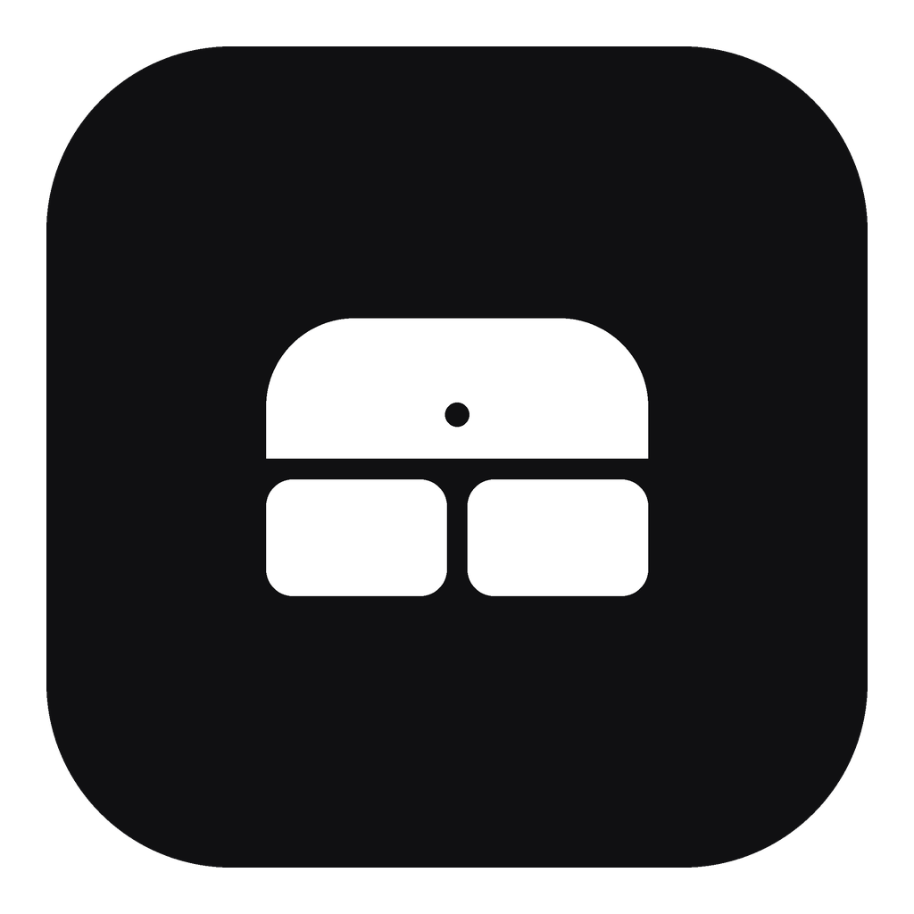

# AirPodsWin



AirPods kutusunu Windows 11 bilgisayarın yanında açtığında macOS bildirimleri gibi sağ üst köşeden kayan bir kart gösterir. Kartta sol, sağ ve kutu pilleri görünür, tek dokunuşla bağlanırsın. AirPods'u kulağına taktığında otomatik olarak bilgisayara geçebilir ve Windows ses çıkışını AirPods'a çevirir.

## Kurulum

1. `AirPodsWin.exe` dosyasını çalıştır. Kurulum gerekmez, .NET de içinde gelir.
2. AirPods kutusunun kapağını bilgisayarın yanında aç. Kart çıkınca **Windows ile eşleştir**e bas, sonra ışık beyaz yanıp sönene kadar kutunun önüne iki kez dokun (AirPods Pro 3, AirPods 4) ya da arkadaki düğmeye basılı tut (eski modeller). Bu yalnızca ilk seferde gerekir.
3. Uygulama sistem tepsisine yerleşir. Sağ tıklayıp **Windows ile başlat** seçeneğini aç.

## Ne yapar

| Durum | Davranış |
|---|---|
| Kutunun kapağı PC yakınında açıldı | Kart aşağıdan yaylanarak çıkar, pilleri gösterir ve **Bağlan** düğmesi sunar |
| **Bağlan**'a basıldı | AirPods iPhone'dan koparılıp PC'ye bağlanır ve varsayılan ses çıkışı yapılır |
| AirPods kulağa takıldı (açık/kapalı seçilebilir) | Otomatik bağlanır, kart "Bağlanıyor…" durumunu gösterir |
| Uygulama açıldı, Bluetooth kapalı | Bluetooth otomatik açılır. Çıkışta yalnızca uygulama açtıysa yeniden kapatılır |
| PC sessizken iPhone'un kilidi PC'nin yanında açıldı ya da iPhone'a arama geldi | PC AirPods'u bırakır, AirPods iPhone'a döner. 3 dakika boyunca kulağa takınca otomatik geri alınmaz |
| Tepsi simgesine sol tık | Kartı ve güncel pilleri gösterir |

Tepsi menüsündeki ayarlar şunlardır: cihaz seçimi, Bluetooth'u otomatik aç/kapat, kutu açılınca kartı göster, kutu açılınca otomatik bağlan, kulağa takınca otomatik bağlan, Windows ile başlat.

Ayar dosyası `%AppData%\AirPodsWin\settings.json` konumundadır. Komşunun AirPods'u da kartı açıyorsa `MinRssi` değerini -62'den -50'ye doğru yükselt.

## Nasıl çalışır

- **Algılama:** AirPods, kutu açıkken ve kulaktayken her saniye birkaç kez Apple "proximity pairing" BLE yayını yapar (üretici kimliği 0x004C, tip 0x07). Uygulama bu yayını Windows'un `BluetoothLEAdvertisementWatcher` API'siyle pasif olarak dinler. Model, pil, şarj, kulakta olma ve kapak durumu buradan çözülür (`src/AirPodsWin.Core/ProximityPairingMessage.cs`).
- **Tanıma:** AirPods adından değil kimliğinden tanınır. Eşleşmiş cihazlarda Windows'un sakladığı Bluetooth aygıt kimliğine bakılır (`VID&0001004C`, yani üretici Apple; `PID` ise model). Eşleşmeden önce bu kimlik okunamadığı için cihaz adresinin üretici kısmı Apple'ın IEEE kayıtlarıyla karşılaştırılır (`tools/gen_apple_oui.py`). Ayrıca cihazın ses cihazı olması şartı aranır. Yakında birden fazla aday varsa kart hangisinin seninki olduğunu sorar.
- **iPhone'a geri verme:** iPhone'lar sürekli Continuity "Nearby Info" yayını yapar (tip 0x10). Bu yayındaki etkinlik kodu ekranın kilitli mi, kullanımda mı, arama mı olduğunu söyler. Çok yakında (güçlü sinyalde) bir iPhone boşta iken kullanıma geçerse ve PC'de ses çalmıyorsa AirPods bırakılır. Yakındaki bir iPad ya da başka birinin iPhone'u da tetikleyebilir. Bu yüzden ayar tepsiden kapatılabilir.
- **Bağlanma:** Windows Ayarlar'daki "Bağlan" düğmesinin kullandığı yol izlenir. Ses uç noktasının arkasındaki KS filtresine Bluetooth ses sürücüsünün `KSPROPERTY_ONESHOT_RECONNECT` özelliği gönderilir. Ardından varsayılan ses aygıtı `IPolicyConfig` ile değiştirilir (`src/AirPodsWin/Audio/BluetoothAudioSwitcher.cs`).

## Sınırlar

- Apple'ın kendi cihazları arasındaki otomatik geçiş iCloud hesabı ve şifreli bir el sıkışmasıyla çalışır. Windows bu zincirin parçası olamaz. Bu yüzden geçiş **PC'ye doğru** çalışır: AirPods PC'ye bağlanınca iPhone onu bırakır. Ters yön (PC'den iPhone'a) için iPhone'daki AirPods menüsü kullanılır, macOS'ta da aynısı geçerlidir.
- AirPods BLE adresini sürekli değiştirir. Bu yüzden "senin" AirPods'un, eşleşmiş modelle eşleşen ve sinyali en güçlü olan AirPods olarak tanınır.
- Gürültü engelleme modu ve kulak algılamayla müzik durdurma, Apple'ın L2CAP tabanlı AAP protokolünü gerektirir. Windows bunu kullanıcı modunda açmadığı için bu sürümde yok.
- Kartın çizimi ve uygulama simgesi bu proje için çizildi (`assets/make_icon.py`). Apple logosu ve Apple'ın resmi görselleri marka/telif nedeniyle kullanılmadı.

## Derleme

```
dotnet test tests/AirPodsWin.Core.Tests
dotnet publish src/AirPodsWin -c Release -r win-x64 --self-contained true -p:PublishSingleFile=true -o out/win-x64
```

GitHub Actions iş akışı (`.github/workflows/airpods.yml`) her push'ta testleri çalıştırır ve exe dosyasını artefakt olarak yükler.
