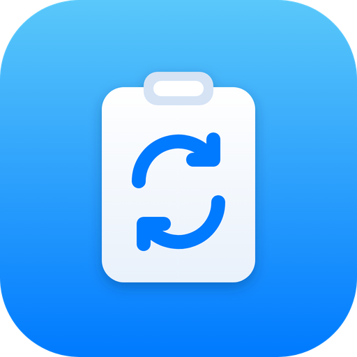

<p align="center"></p>

# UniClip: Apple → Windows 11 Universal Clipboard

Apple'ın Universal Clipboard protokolü kapalı (iCloud + Bluetooth LE + AWDL) ve Windows'ta
taklit edilemiyor. UniClip aynı deneyimi yerel ağ üzerinden kurar:

```
iPhone/iPad ──(Kısayol, Arkaya Dokunma)──┐
                                          ├──► Windows 11: UniClip servisi ──► Ctrl+V
Mac ──────(arka plan betiği, otomatik)───┘         ▲
                                                   └── Windows'ta kopyalanan metin Mac/iPhone'a geri gelir
```

**Ana yol iPhone/iPad Kısayolu'dur** ve başka hiçbir cihazın açık olmasını gerektirmez.
Mac betiği isteğe bağlıdır; yalnızca Mac açık ve sizin oturumunuzdayken çalışır.

## 1. Windows 11 (bir kez)

1. Python 3.10+ kurun (python.org, kurulumda "Add python.exe to PATH" işaretli).
2. Bu klasördeki `windows` klasörünü örneğin `C:\UniClip` içine kopyalayın.
3. Wi-Fi ağ profiliniz **Özel** olmalı (Ayarlar → Ağ ve İnternet → Wi-Fi → ağınız → Özel ağ).
4. Yönetici PowerShell açıp:
   ```powershell
   cd C:\UniClip
   powershell -ExecutionPolicy Bypass -File install.ps1
   ```
   Bu, güvenlik duvarında 8765 portunu yalnızca özel ağ için açar, servisi oturum açılışında
   arka planda başlatır ve size **Adres** ile **Token**'ı yazar. İkisini not edin.

Gelen her içerikte Windows köşesinde küçük bir bildirim çıkar. Kapatmak için
`uniclip_config.json` içinde `"notify": false` yapın.

## 2. iPhone / iPad: "Windows'a Gönder" Kısayolu

Kestirmeler uygulamasında yeni kısayol oluşturun:

1. **Panoyu Al**
2. **Girdiden Görüntüleri Al** (girdi: Pano)
3. **Eğer** Görüntüler *herhangi bir değere sahipse*
   - **Görüntüyü Dönüştür** → PNG (HEIC'i Windows'un anlayacağı biçime çevirir)
   - **URL'nin İçeriğini Al**: URL = `http://ADRES:8765/clip`, Yöntem = POST,
     Başlıklar: `X-Token` = TOKEN, `X-Device` = iPhone, `Content-Type` = `image/png`,
     İstek Gövdesi = Dosya → *Dönüştürülmüş Görüntü*
4. **Değilse**
   - **URL'nin İçeriğini Al**: aynı URL, POST, Başlıklar: `X-Token`, `X-Device`,
     `Content-Type` = `text/plain; charset=utf-8`, İstek Gövdesi = Dosya → *Pano*
5. **Eğer Sonu**

**Tek dokunuşla tetikleme:** Ayarlar → Erişilebilirlik → Dokunma → Arkaya Dokunma →
Çift Dokunma → "Windows'a Gönder". Artık kopyala, telefonun arkasına iki kez vur, Windows'ta Ctrl+V.

**Ters yön (Windows → iPhone)** için ikinci bir kısayol: **URL'nin İçeriğini Al**
(`http://ADRES:8765/clip`, GET, başlık `X-Token`) → **Panoya Kopyala**. Bunu da Üçlü Dokunma'ya atayabilirsiniz.

## 3. Mac (isteğe bağlı, iki yönlü metin)

```bash
mkdir -p ~/uniclip && cp mac/uniclip_mac.sh ~/uniclip/ && chmod +x ~/uniclip/uniclip_mac.sh
# Hızlı deneme:
UNICLIP_URL=http://ADRES:8765/clip UNICLIP_TOKEN=TOKEN ~/uniclip/uniclip_mac.sh
```
Kalıcı olması için `mac/com.uniclip.sync.plist` içindeki yol, adres ve token'ı doldurup
`~/Library/LaunchAgents/` altına koyun ve `launchctl load ~/Library/LaunchAgents/com.uniclip.sync.plist`.

## Sınırlar ve güvenlik

- Cihazlar aynı yerel ağda olmalı. Trafik şifresiz HTTP'dir; token yalnızca yetkisiz cihazları
  engeller. Kafe/otel gibi ortak ağlarda kullanmayın (zaten güvenlik duvarı kuralı sadece Özel ağda açık).
- iPhone kopyalamayı arka planda izleyemez (iOS kısıtı); bu yüzden iPhone tarafı tek dokunuş ister.
  Mac köprüsü varsa bu adım da kalkar.
- Mac betiği yalnızca metni taşır; görseller için iPhone kısayolunu kullanın.
- Desteklenen görseller: PNG, JPEG, GIF, BMP (en fazla 25 MB).

## Hızlı test (Windows'ta, PowerShell)
```powershell
Invoke-RestMethod -Method Post -Uri http://localhost:8765/clip -Headers @{ "X-Token" = "TOKEN" } -Body "merhaba" -ContentType "text/plain; charset=utf-8"
```
Ardından Not Defteri'nde Ctrl+V.
